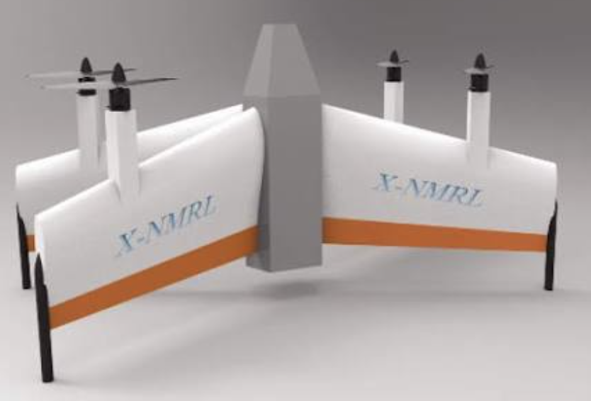

# Skid-to-turn quad tailsitter

This vehicle is a quad tailsitter with four fixed propellers and no control
surfaces. The proposed cruise controller will control the vehicle's velocity
vector using skid-to-turn maneuvers. It will require a new attitude controller
that tracks yaw as well as roll and pitch, because PX4's current fixed-wing
attitude controller removes yaw attitude error and adds coordinated-turn rate
commands.

The design builds on PX4's existing motor-only quad tailsitter. The vehicle
description and control objectives below record the intended behavior. The new
controllers and an airframe preset for this vehicle have yet to be implemented.

Source revision: PX4-Autopilot `main`, checked on 2026-11-01 at
[`53b193a6fb1c7aec34fb7334a4ca91d4b9b20332`][revision]. Source links are pinned
to that revision.

## Vehicle description

The vehicle has a central fuselage, a wing structure, and four propellers fixed
to the airframe, as illustrated in Figure 1. It takes off and lands upright.
Transition rotates the entire aircraft roughly 90 degrees into forward flight,
where all four propellers point in the nominal direction of travel. The
propellers retain their orientation relative to the airframe throughout the
transition.



*Figure 1. Reference image supplied for the motor-only quad tailsitter design.*

The vehicle has no ailerons, elevator, or rudder. Attitude control comes from
individual motor commands, with the allocation model accounting for thrust
lever arms and propeller reaction torques. Collective thrust and the forces
generated by the wing and body determine translational motion.

The forward-flight description applies to nominal cruise. During a skid turn,
the aircraft can point away from its air-relative velocity direction, so thrust
and velocity need not remain aligned.

## Relationship to PX4's quad tailsitter

PX4 already includes a four-motor tailsitter without control surfaces in the
[`4018_gz_quadtailsitter` airframe preset][quad-preset]. This is a Gazebo
simulation preset, and its geometry, gains, and transition settings belong to
that model. It provides a starting point for understanding the software path
needed by this vehicle.

Table 1 lists the settings that establish its vehicle identity and motor-control
configuration.

*Table 1. Relevant settings in PX4's existing quad tailsitter simulation preset.*

| Parameter | Value | Purpose |
| --- | --- | --- |
| `MAV_TYPE` | `20` | Identifies the vehicle as a quadrotor tailsitter. |
| `VT_TYPE` | `0` | Selects the tailsitter VTOL implementation. |
| `CA_AIRFRAME` | `4` | Selects tailsitter control allocation. |
| `CA_ROTOR_COUNT` | `4` | Configures four motors. |
| `CA_SV_CS_COUNT` | `0` | Configures zero control surfaces. |
| `VT_FW_DIFTHR_EN` | `7` | Enables differential thrust for yaw, roll, and pitch in forward flight. |

The [differential-thrust parameter definitions][diff-thrust-parameters] specify
the enabled axes and their scaling parameters. In forward flight,
[`Tailsitter::fill_actuator_outputs()`][tailsitter-routing] routes enabled
fixed-wing torque commands to the motor allocation path. This supports
motor-only actuation, while the controllers upstream determine the maneuver
those motors execute.

The initial plan retains the existing VTOL tailsitter classification and adds
an alternative cruise-control path. PX4 can continue reporting rotary-wing
flight during hover and fixed-wing flight during cruise, following
[`Commander::vtolStatusUpdate()`][vtol-status-update]. That classification
identifies the active flight configuration, while the proposed controller
changes how the vehicle is controlled within cruise. See
[flight modes](../concepts/flight_modes.md) for the distinction between a flight
mode and the VTOL transition state.

## Skid-to-turn cruise

The selected maneuver strategy is skid-to-turn. The controller will regulate a
chosen roll attitude, initially wings level, and use pitch and yaw motion to
produce the forces needed to change the flight path. Sideslip is permitted as
part of the maneuver. This is a control objective that must be evaluated against
the vehicle's available aerodynamic force and motor authority.

Differential thrust first creates a control moment that rotates the airframe.
The rotation changes the thrust direction relative to the flight path and
changes the airflow seen by the wing and body. The resulting propulsive and
aerodynamic forces change the velocity vector. Controlling yaw therefore
requires tracking the resulting translational motion as well as the aircraft's
orientation.

The force model must distinguish angle of attack, which describes the vertical
inclination of the airflow in the cruise body frame, from sideslip, which
describes its lateral inclination. Their relationship to force and moment
depends on the airframe and operating condition. Pitch and yaw responses must
be modeled separately before assuming they are symmetric or decoupled. The
[aerodynamic references](#aerodynamic-references) provide the background for
these relationships.

## Controlling the velocity vector

The primary motion command will be a desired velocity vector. For navigation,
the proposed interface expresses ground-relative velocity in a local
north-east-down (NED) frame as `(v_north, v_east, v_down)`. The horizontal
components specify motion over the ground, and the vertical component specifies
climb or descent, with positive values directed downward. Holding altitude
requires a zero desired vertical velocity.

Aerodynamic calculations require air-relative velocity in a consistent frame.
The wind estimate connects it to ground-relative velocity:

```text
v_air = v_ground - v_wind
```

All three vectors in this expression use the same navigation frame. The
aerodynamic model then transforms air-relative velocity into the cruise body
frame to determine angle of attack and sideslip.

Heading, ground course, and airspeed direction must remain separate quantities.
Heading describes where the aircraft points, ground course describes horizontal
travel over the ground, and airspeed direction describes horizontal travel
relative to the air. During skid-to-turn flight, the controller may require a
heading that differs from either velocity direction. PX4's
[`FixedWingLateralSetpoint` definition][lateral-setpoint] already distinguishes
course from airspeed direction and equates airspeed direction with heading only
when sideslip is absent.

The proposed control sequence is:

1. Compare the desired and estimated velocity vectors to determine a required
   acceleration, subject to the vehicle's limits.
2. Use the force model to select an attitude and collective thrust that produce
   that acceleration while regulating the chosen roll attitude. Include gravity
   when determining the force needed to maintain or change altitude.
3. Use the new attitude controller to track the complete attitude target,
   including yaw, and generate angular-rate targets.
4. Track the angular-rate targets and allocate the required thrust and moments
   to the four motors through the VTOL motor-control path.

Yaw attitude is an intermediate control target in this sequence. The velocity
response determines whether the requested maneuver is achieved. In particular,
changing heading while the vehicle continues along its previous path would
leave a velocity error for the outer controller to resolve.

The model and feedback must account for wind, aerodynamic coupling, and motor
limits. The choice of a velocity-vector objective does not establish a specific
controller equation or gains. Those require the vehicle's force-and-moment
model and its dynamic response.

## Why the fixed-wing attitude controller must be replaced

The existing fixed-wing path assumes that lateral maneuvers are achieved through
banking and coordinated turns. The proposed vehicle instead needs a controller
that can track the yaw attitude required by skid-to-turn velocity control.
Several parts of the current path therefore need changes.

### Yaw attitude error is removed

[`computeAttitudeError()`][fw-attitude-error] constructs a yaw offset that
removes yaw attitude error before calculating the error used for attitude
feedback. Its source comment explicitly states the assumption that fixed-wing
aircraft have no direct yaw authority. This is an assumption of that controller,
and this vehicle's motor-generated yaw authority must be established from its
actuator geometry and dynamics.

As a result, passing a new yaw attitude target to the current controller does
not provide the yaw attitude tracking required by this design. The replacement
must retain yaw error and control orientation about all three axes.

### Coordinated-turn rate commands are added

The [current attitude-controller implementation][fw-turn-coordination] adds
pitch- and yaw-rate feedforward commands based on attitude and airspeed to
coordinate a banked turn. The proposed controller will generate its rate targets
from the skid-to-turn attitude objective and vehicle dynamics.

Changing the coordinated-turn feedforward alone would leave the yaw-error
removal in place. The replacement must address both parts of the current
attitude-control behavior.

### Upstream lateral control commands bank angle

The [lateral control path][fw-lateral-control] turns requested lateral
acceleration into a roll target. Its
[`mapLateralAccelerationToRollAngle()` function][fw-acceleration-to-roll] uses
the coordinated level-turn relationship between lateral acceleration, gravity,
and bank angle.

The proposed velocity controller must supply the attitude and thrust needed for
skid-to-turn motion while regulating the chosen roll attitude. Replacing the
attitude controller must therefore be accompanied by changes to the upstream
lateral control path. An unchanged bank-angle command would continue asking
the new attitude controller to execute the previous maneuver strategy.

## Initial integration scope

The development starts from the existing hover controllers, tailsitter
transition logic, and motor allocator. Their reuse will be evaluated with the
vehicle model. Cruise will use the new velocity-vector and attitude-control
path, with controller selection scoped to this airframe.

The implementation must preserve the frame transformations between the hover
body frame and PX4's virtual fixed-wing frame. The existing
[tailsitter attitude-frame conversion][tailsitter-frame] documents that
relationship. Each setpoint topic must also have a defined publisher in each
flight phase so the stock and replacement controllers do not issue competing
commands.

Reuse of the fixed-wing rate controller requires a separate review of gains,
torque scaling, and saturation feedback. For example,
[`FW_ARSP_SCALE_EN`][rate-scaling] accounts for changes in aerodynamic
control-surface effectiveness with airspeed. Motor-generated torque requires
scaling appropriate to its own response. Navigation modes such as Mission,
Hold, and Return will also need evaluation with the new cruise controller and
its maneuver limits.

## Aerodynamic references

The following references support the distinction between attitude and velocity,
the use of angle of attack and sideslip in force models, and the treatment of
coupled flight dynamics. The vehicle's coefficients, motor response, and control
limits remain to be established for its operating conditions.

1. George M. Siouris, *Missile Guidance and Control Systems*, Springer, 2004.
   Section 3.1, especially pp. 56 and 60–61, describes aerodynamic forces and
   airflow angles. Section 3.3.2, pp. 91–92, discusses skid-to-turn and
   bank-to-turn models and their assumptions.
2. John H. Blakelock, *Automatic Control of Aircraft and Missiles*, second
   edition, Wiley, 1991. Section 3-1, pp. 112–113, distinguishes sideslip from yaw
   and introduces lateral flight dynamics.
3. Jack N. Nielsen, *Missile Aerodynamics*. Section 10-2, pp. 353–355, describes
   force-and-moment dependencies and stability derivatives.

[revision]: https://github.com/PX4/PX4-Autopilot/commit/53b193a6fb1c7aec34fb7334a4ca91d4b9b20332
[quad-preset]: https://github.com/PX4/PX4-Autopilot/blob/53b193a6fb1c7aec34fb7334a4ca91d4b9b20332/ROMFS/px4fmu_common/init.d-posix/airframes/4018_gz_quadtailsitter
[diff-thrust-parameters]: https://github.com/PX4/PX4-Autopilot/blob/53b193a6fb1c7aec34fb7334a4ca91d4b9b20332/src/modules/vtol_att_control/vtol_att_control_params.yaml#L212-L259
[tailsitter-routing]: https://github.com/PX4/PX4-Autopilot/blob/53b193a6fb1c7aec34fb7334a4ca91d4b9b20332/src/modules/vtol_att_control/tailsitter.cpp#L329-L348
[vtol-status-update]: https://github.com/PX4/PX4-Autopilot/blob/53b193a6fb1c7aec34fb7334a4ca91d4b9b20332/src/modules/commander/Commander.cpp#L2405-L2435
[lateral-setpoint]: https://github.com/PX4/PX4-Autopilot/blob/53b193a6fb1c7aec34fb7334a4ca91d4b9b20332/msg/versioned/FixedWingLateralSetpoint.msg
[fw-attitude-error]: https://github.com/PX4/PX4-Autopilot/blob/53b193a6fb1c7aec34fb7334a4ca91d4b9b20332/src/modules/fw_att_control/FixedwingAttitudeControl.hpp#L78-L94
[fw-turn-coordination]: https://github.com/PX4/PX4-Autopilot/blob/53b193a6fb1c7aec34fb7334a4ca91d4b9b20332/src/modules/fw_att_control/FixedwingAttitudeControl.cpp#L275-L296
[fw-lateral-control]: https://github.com/PX4/PX4-Autopilot/blob/53b193a6fb1c7aec34fb7334a4ca91d4b9b20332/src/modules/fw_lateral_longitudinal_control/FwLateralLongitudinalControl.cpp#L295-L344
[fw-acceleration-to-roll]: https://github.com/PX4/PX4-Autopilot/blob/53b193a6fb1c7aec34fb7334a4ca91d4b9b20332/src/modules/fw_lateral_longitudinal_control/FwLateralLongitudinalControl.cpp#L884-L886
[tailsitter-frame]: https://github.com/PX4/PX4-Autopilot/blob/53b193a6fb1c7aec34fb7334a4ca91d4b9b20332/src/modules/fw_att_control/FixedwingAttitudeControl.hpp#L114-L117
[rate-scaling]: https://github.com/PX4/PX4-Autopilot/blob/53b193a6fb1c7aec34fb7334a4ca91d4b9b20332/src/modules/fw_rate_control/fw_rate_control_params.yaml#L208-L221
